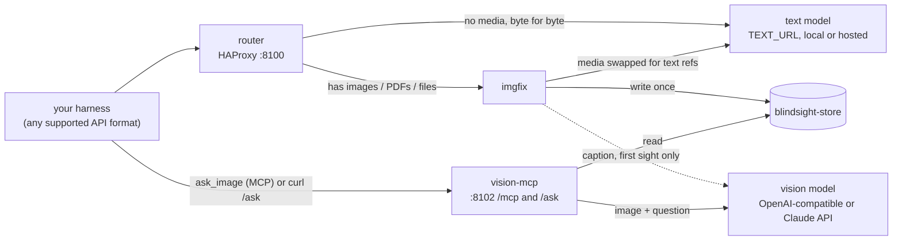

# blindsight

**Give text-only LLMs eyes.**

blindsight lets any text-only model, in any harness (Claude Code, Codex, OpenCode, OpenAI-, Ollama- or Gemini-style
clients), handle images and PDFs. A proxy swaps every image for a short text reference. The text model can then ask a
separate vision model targeted questions about it. Both models can be local servers or hosted APIs.

Tested end to end with Claude Code, Codex CLI and OpenCode in front of a text-only GLM-5.3 (Anthropic, OpenAI Chat
and OpenAI Responses formats), with the vision model reached through both the OpenAI-compatible and the Anthropic API.
In each, the model read a tiny printed code off a test image by calling `ask_image`.

## Demo


GLM-5.3 (text-only) in Claude Code, run from T3 Code (a GUI for coding agents; the thread list is blurred): the user
drops in a photo and asks what it is, then whether the connector is burnt. GLM answers each question with one
`ask_image` call. Clip is sped up.
[Full-resolution MP4](docs/demo.mp4).

## The problem

Text-only models reject image parts, usually with HTTP 400. Agent harnesses re-send the whole history every turn, so
after one pasted screenshot every later turn fails too: the session is "poisoned".

## How it works



1. **router** (HAProxy, `:8100`) is the only API address your client uses. Requests without media go to the text
   model (`TEXT_URL`) byte for byte.
2. Requests with image, document or file parts go to **imgfix** (a mitmproxy addon). It stores each file under a
   content-hashed id and replaces the part with fixed text:
   ```
   [image img_<16hex> | WxH fmt | caption] The model cannot see images. To inspect this one, call the ask_image tool with image_id="img_<16hex>" and a specific question.
   ```
   The caption comes from the vision model on first sight only (`no preview` if that fails or is off). PDFs become
   their `pdftotext` text plus a `pdf_<16hex>` id whose pages can be rendered.
3. The text model asks **vision-mcp** (`:8102`) with `ask_image(image_id, question, context?, page?, region?)`: as an
   MCP tool (`/mcp`) or by running curl against `/ask`. It shows the stored image (or a zoomed `region`, or a PDF
   `page`) to the vision model and returns the answer as text.

The swap runs on every request, so images already in the history are covered too.

## Design points

- **Prefix-cache friendly.** The store is write-once and references are built only from it and the configuration, so
  the same image yields byte-identical text every turn and the text model's prefix cache keeps hitting.
- **Fail closed.** No media part ever reaches the text model. A part that can't be handled becomes
  `[image unavailable: could not be decoded]`.
  - The router sends a request through imgfix when it has a media marker (case-insensitive, any method) or anything
    that could hide one: compression, a NUL byte (UTF-16), a body not starting with `{`, `\u00XX` escapes, or a size
    of ~30 MiB and up.
  - imgfix parses strictly. Invalid JSON, duplicate or case-variant keys, and any media-shaped part it could not
    replace get a 400 instead of being forwarded.
  - If imgfix is down, every request it would get receives a clear, non-retryable 400 telling you to run
    `docker compose up -d imgfix`; other requests are unaffected.
  - A body still arriving after 300 s gets 408. WebSocket and other upgrade requests get 400.
- **Your keys stay yours.** The client's own API key headers pass through to `TEXT_URL` untouched. Logs never hold
  bodies, questions, answers, key headers or query strings (the router logs method and path only).
- **Limits.** Images up to 50 MP and 32 MiB each (PNG, JPEG, GIF, WebP); request bodies up to 64 MiB. New files are
  refused while the store's disk has less than `IMGFIX_MIN_FREE_GB` free.
- **Read-only token counting.** Paths ending `/count_tokens` or `/input_tokens` store, caption and fetch nothing.
- **Hardened containers.** Non-root, read-only filesystems, memory/CPU/PID limits, poppler under `prlimit`,
  DNS-rebinding guard on `/mcp` and `/ask`, https upstreams always verified, ports bound to `127.0.0.1` by default.

## What works

| Client API format | Paths (any prefix) | Media parts replaced |
|---|---|---|
| Anthropic Messages | `/v1/messages` | `image`, `document` (base64, url, file) |
| OpenAI Chat Completions | `/v1/chat/completions` | `image_url` (also vLLM's untyped form), `file` |
| OpenAI Responses | `/v1/responses` | `input_image`, `input_file`, `computer_screenshot` |
| Ollama native | `/api/chat`, `/api/generate` | `images` (refs appended to `content` / `prompt`) |
| Gemini native | `/v1beta/models/<m>:generateContent`, `:streamGenerateContent`, `:countTokens` | `inline_data` / `inlineData`, `file_data` / `fileData` |

- **Media:** images as data URLs or base64; image URLs (see `FETCH_REMOTE_IMAGES`); PDFs; `text/plain` files (inlined
  as text). Anything else becomes the "unavailable" text.
- **Text model:** any http(s) URL, with optional path prefix: a local server or a hosted API. The client's path and
  query are appended (`/v1/messages` -> `TEXT_URL/v1/messages`). blindsight never translates formats, so the text API
  must serve the format your client speaks.
- **Vision model:** `VISION_API=openai` (any OpenAI-compatible `chat/completions` endpoint that accepts image data
  URLs) or `VISION_API=anthropic` (Claude). `VISION_HEADERS` adds request headers, `VISION_TOKEN_PARAM` picks
  `max_tokens` or `max_completion_tokens`, `VISION_EXTRA_BODY` merges JSON into every request (`null` deletes a key).

## Pick your setup

| Harness | Point it at | How the model looks |
|---|---|---|
| Claude Code | `ANTHROPIC_BASE_URL=http://127.0.0.1:8100` | MCP (see Quick start) |
| Codex CLI | `~/.codex/config.toml`: a `[model_providers.<id>]` with `base_url = "http://127.0.0.1:8100/v1"` (Responses API: the text API must serve `/v1/responses`) | MCP: `[mcp_servers.vision]` with `url = "http://127.0.0.1:8102/mcp"` (its read-only sandbox blocks the `http` hint's curl) |
| OpenAI-compatible clients (e.g. OpenCode, Cline, Continue) | base URL `http://127.0.0.1:8100/v1` | MCP if the client supports it, else `ASK_HINT=http` or `CAPTION_MODE=detailed` |
| Open WebUI, other Ollama-native clients | Ollama URL `http://127.0.0.1:8100` | No MCP: `CAPTION_MODE=detailed` and `ASK_HINT=none` (or `http`) |
| Gemini-native clients (Google GenAI SDK) | base URL `http://127.0.0.1:8100` | MCP if supported, else `ASK_HINT=http` or `CAPTION_MODE=detailed` |

The three ways the model can look:

| Setting | The model sees | For |
|---|---|---|
| `ASK_HINT=mcp` (default) | "call the ask_image tool with image_id=..." | harnesses with MCP: register `http://127.0.0.1:8102/mcp` |
| `ASK_HINT=http` | "run: `curl -s -G http://127.0.0.1:8102/ask --data-urlencode image_id=... --data-urlencode "question=..."`" | harnesses that can run shell commands |
| `CAPTION_MODE=detailed` + `ASK_HINT=none` | a ~200-word description quoting all visible text, nothing to call | no tools at all |

A client in a container: `127.0.0.1` is that container, not your host. Use an address that reaches the published
ports, and set `ASK_URL` to it for the `http` hint.

## Quick start

Requires Docker with Compose.

```sh
cp .env.example .env    # set TEXT_URL, VISION_MODEL (+ VISION_BASE_URL, VISION_API_KEY as needed)
docker compose up -d --build --wait
docker compose ps       # router, imgfix and vision-mcp should all be "healthy"
```

If `--wait` fails or a service is not healthy, run `docker compose logs router imgfix vision-mcp`: a configuration
error (e.g. a bad `TEXT_URL` or invalid `VISION_EXTRA_BODY`) stops the service at startup with a clear message. The
router's first log line shows how it parsed `TEXT_URL`.

Claude Code, from the directory where you will work with the text model:

```sh
# Register the tool for this directory only
claude mcp add --scope local --transport http vision http://127.0.0.1:8102/mcp

# Point Claude Code at the router
ANTHROPIC_BASE_URL=http://127.0.0.1:8100 \
ANTHROPIC_AUTH_TOKEN=<your text API's key, or any placeholder> \
ANTHROPIC_MODEL=<your text model's served name> \
ANTHROPIC_DEFAULT_HAIKU_MODEL=<the same name> \
claude
```

- `ANTHROPIC_DEFAULT_HAIKU_MODEL`: Claude Code also makes small background calls (e.g. session titles) with its
  "haiku" model, so it must name a model your text API serves.
- `--scope local` keeps `ask_image` out of your other sessions. With `--scope user` it is in every session, including
  ones with image-capable models, where its "you cannot see images" text is wrong, and it shows as failed whenever
  blindsight is stopped.
- Sessions started before the tool was registered won't have `ask_image`; start a new one.
- Optional: allow `mcp__vision__ask_image` in Claude Code permissions to skip the prompt on each call.

The stack does not start by itself. After a reboot or Docker restart, run `docker compose up -d` in this directory
again; until then every request to the router fails, not just image ones. To have Docker restart it, add a
`compose.override.yaml` (git-ignored) next to `compose.yaml`:

```yaml
services:
  router: { restart: unless-stopped }
  imgfix: { restart: unless-stopped }
  vision-mcp: { restart: unless-stopped }
```

## Configuration

Set in `.env` (each variable is documented, with examples, in `.env.example`). Changes apply after
`docker compose up -d`.

**Text model** (`TEXT_URL`; the API key is your client's own):

| Text API | `TEXT_URL` | Client format |
|---|---|---|
| local vLLM, SGLang, llama.cpp | `http://host.docker.internal:8000` | whatever the server serves |
| local Ollama | `http://host.docker.internal:11434` | whatever the server serves |
| DeepSeek | `https://api.deepseek.com/anthropic` | Anthropic |
| Kimi / Moonshot | `https://api.moonshot.ai/anthropic` | Anthropic |
| GLM / Z.ai | `https://api.z.ai/api/anthropic` | Anthropic |
| OpenRouter | `https://openrouter.ai/api` | OpenAI (client base `http://127.0.0.1:8100/v1`) |
| Groq | `https://api.groq.com/openai` | OpenAI (client base `http://127.0.0.1:8100/v1`) |

**Vision model:**

| Provider | Settings |
|---|---|
| local vLLM | `VISION_BASE_URL=http://host.docker.internal:8001/v1` `VISION_MODEL=Qwen/Qwen3-VL-8B-Instruct` `VISION_EXTRA_BODY='{"chat_template_kwargs":{"enable_thinking":false}}'` |
| Ollama | `VISION_BASE_URL=http://host.docker.internal:11434/v1` `VISION_MODEL=qwen2.5vl:7b` |
| OpenAI | `VISION_BASE_URL=https://api.openai.com/v1` `VISION_MODEL=gpt-6-luna` `VISION_API_KEY=sk-...` `VISION_TOKEN_PARAM=max_completion_tokens` `VISION_EXTRA_BODY='{"reasoning_effort":"none"}'` |
| Claude | `VISION_API=anthropic` `VISION_MODEL=claude-haiku-5-5` `VISION_API_KEY=sk-ant-...` `VISION_EXTRA_BODY='{"temperature":null,"thinking":{"type":"disabled"}}'` |
| Gemini | `VISION_BASE_URL=https://generativelanguage.googleapis.com/v1beta/openai` `VISION_MODEL=gemini-3.6-flash` `VISION_API_KEY=<key>` `VISION_EXTRA_BODY='{"reasoning_effort":"minimal","temperature":null}'` |
| OpenRouter | `VISION_BASE_URL=https://openrouter.ai/api/v1` `VISION_MODEL=qwen/qwen3-vl-8b-instruct` `VISION_API_KEY=sk-or-...` |
| Azure OpenAI | `VISION_BASE_URL='https://<resource>.openai.azure.com/openai/deployments/<deployment>/chat/completions?api-version=2024-10-21'` `VISION_MODEL=<deployment>` `VISION_HEADERS='{"api-key":"<key>"}'` |

Thinking models: turn thinking off (or to its lowest level). Thinking tokens count toward the caption's token limit
(60 short, 600 detailed), and a cut-off caption is stored as "no preview" for good.

**All variables:**

| Variable | Default | Meaning |
|---|---|---|
| `TEXT_URL` | `http://host.docker.internal:8000` | Text model API base: `http(s)://host[:port][/prefix]`, no query. |
| `TEXT_CA_FILE` | *(empty)* | PEM path inside the containers that replaces the system CAs for an https `TEXT_URL` (an error with an http one). |
| `PASSTHROUGH_MODELS` | *(empty)* | Comma-separated model names or globs (e.g. `'claude-*,gpt-4o*'`) forwarded unchanged, images included. |
| `VISION_API` | `openai` | `openai` (OpenAI-compatible `chat/completions`) or `anthropic` (Claude Messages). |
| `VISION_BASE_URL` | *(empty)* | Empty: `http://host.docker.internal:8001/v1` (openai) or `https://api.anthropic.com` (anthropic). Also takes a full endpoint URL (query kept) or a bare `host:port`. |
| `VISION_MODEL` | *(required)* | Model name sent in every vision request. |
| `VISION_API_KEY` | *(empty)* | Sent as `Authorization: Bearer` (openai) or `x-api-key` (anthropic). Never logged. |
| `VISION_HEADERS` | *(empty)* | JSON object of extra headers, applied last (can replace the auth header). Never logged. |
| `VISION_TOKEN_PARAM` | `max_tokens` | openai only: `max_tokens` or `max_completion_tokens`. |
| `VISION_EXTRA_BODY` | `{}` | JSON merged into every vision request; `null` deletes a key; may not set `model`, `messages`, `stream`, `system`. |
| `CAPTION_MODE` | `short` | `short` (one sentence), `detailed` (~200 words, all visible text quoted) or `off` (`no preview`). |
| `CAPTION_TIMEOUT` | *(empty)* | Seconds per caption. Empty: 8 (short) or 45 (detailed). |
| `ASK_HINT` | `mcp` | What the reference tells the model to do: `mcp`, `http` (curl `ASK_URL`) or `none`. |
| `ASK_URL` | `http://127.0.0.1:<MCP_PORT>/ask` | Where the harness reaches `/ask` (used in the `http` hint). |
| `FETCH_REMOTE_IMAGES` | `false` | Download image URLs once, on first sight. |
| `FETCH_ALLOW_PRIVATE` | `false` | Let those downloads reach private, loopback and link-local addresses. |
| `BIND_ADDR` | `127.0.0.1` | Address the published ports bind to. |
| `ROUTER_PORT` | `8100` | Router port (point your client here). |
| `MCP_PORT` | `8102` | vision-mcp port (`/mcp` and `/ask`). |
| `MCP_ALLOWED_HOSTS` | `127.0.0.1:*,localhost:*,vision-mcp:*` | Host-header allowlist for `/mcp` and `/ask` (DNS-rebinding guard); `*` disables it. |
| `IMGFIX_MIN_FREE_GB` | `5` | Below this much free disk, new images/PDFs become "unavailable" text. |

**Docker host.** `host.docker.internal` is the Docker host. Docker Desktop (macOS, Windows) forwards it to the host's
loopback, so model servers on `127.0.0.1` work. On Linux it is the Docker bridge address (via `extra_hosts`), so model
servers on the host must listen on `0.0.0.0` or that bridge address (e.g. `OLLAMA_HOST=0.0.0.0`,
`llama-server --host 0.0.0.0`, SGLang `--host 0.0.0.0`, LM Studio "Serve on Local Network"), and a host firewall
(e.g. ufw) must allow Docker's bridge networks.

**Private CA.** For an https `TEXT_URL` with a private or self-signed certificate, mount the PEM (world-readable) with
`compose.override.yaml` and set `TEXT_CA_FILE=/certs/ca.pem`. The certificate must name the `TEXT_URL` host.

```yaml
services:
  router: { volumes: [ "./my-ca.pem:/certs/ca.pem:ro" ] }
  imgfix: { volumes: [ "./my-ca.pem:/certs/ca.pem:ro" ] }
```

**Remote images.** With `FETCH_REMOTE_IMAGES=false` an image URL becomes
`[image url_<16hex> | remote image not fetched: <url>]`. With `true`, each URL is fetched once (<= 32 MiB, 10 s,
3 redirects, 8 new URLs per request) and stored like a pasted image; the outcome, success or failure, is recorded so
every later turn shows the same text. SSRF guard: every resolved address of every hop must be public, and imgfix
connects only to the address it checked. `FETCH_ALLOW_PRIVATE=true` lifts that (imgfix then reaches your LAN and the
Docker host: trusted clients only). Document/PDF URLs are never fetched.

**Upgrading from v1.** Replace `TEXT_HOST` / `TEXT_PORT` with `TEXT_URL=http://<host>:<port>` and delete both; if
either is still set, the router stops at startup and says so.

**Network exposure.** Neither port has authentication. If you set `BIND_ADDR` to a LAN address, add that `host:port`
to `MCP_ALLOWED_HOSTS` (and point `ASK_URL` at it for the `http` hint); anyone who can reach it can use your models.

## The image store

Images, PDFs and their metadata live in the named volume `blindsight-store` (Docker name
`blindsight_blindsight-store`). `docker compose down` keeps it; `docker compose down -v` deletes it.

Nothing is pruned automatically. To prune by hand (never delete `meta/`: it keeps old references byte-stable; a pruned
file comes back when the same image is sent again, until then `ask_image` reports an unknown id):

```sh
# size
docker compose run --rm --no-deps --entrypoint du imgfix -sh /store/img /store/pdf /store/meta
# raw files older than 30 days
docker compose run --rm --no-deps --entrypoint find imgfix /store/img /store/pdf -type f -mtime +30 -print -delete
# stale temp files
docker compose run --rm --no-deps --entrypoint find imgfix /store -name '.tmp-*' -mmin +60 -print -delete
```

## Tests

All run in Docker with stub models; no GPU or network needed.

```sh
docker compose -f imgfix/compose.dev.yaml run --rm --build test
docker compose -f vision-mcp/compose.dev.yaml run --rm --build test   # includes the shared vision_api tests
test/run.sh    # full stack: router + imgfix + vision-mcp, two configurations; cleans up after itself
```

`test/run.sh` covers every client format, an https text upstream with a test CA and path prefix (plus routers that
must refuse a bad certificate), both vision APIs, fail-closed paths, secrets in logs, and router/imgfix agreement on
`TEXT_URL` parsing. `KEEP=1` leaves the stack up for inspection; `TEST_PROJECT=<name>` sets the compose project.

## Real-world deployment

Deployed in front of GLM-5.3 (753B MoE, text-only) on 8x NVIDIA CMP 170HX
([recipe](https://github.com/cebeuq/glm53-cmp170hx-recipe)), with a Qwen3.8-27B vision model on a 9th card. From
production logs:

- The image swap adds ~16-22 ms per request.
- Each `ask_image` call takes ~1.2-2.8 s.
- The prefix cache keeps working, because references are byte-identical every turn.

## Limitations

- No format translation: the text API must serve the client's format.
- WebSocket transports are refused (400): use the client's plain HTTP mode.
- Requests imgfix can't parse get a 400, except clearly non-JSON uploads (e.g. `multipart/*`, `audio/*`) with no
  media markers, which pass unchanged.
- `file_id`-only parts (provider-side uploads) can't be read: they become `[image unavailable: file_id <id> not readable]`.
- An https `TEXT_URL` needs a host name: the router refuses an IP literal (certificates are checked against DNS
  names). Name the address with `extra_hosts` in `compose.override.yaml`. The host must also resolve when the router
  starts.
- On Linux, model servers on the host must listen on `0.0.0.0` or the bridge address (see Configuration).
- The store is never pruned automatically.
- Captions are stored once per image: a new `CAPTION_MODE` applies to new images only. `ASK_HINT` and `ASK_URL` are
  not stored: changing them changes the text of every image and PDF, old ones included (one prefix-cache miss).
- Captions and answers are only as good as the vision model.

## License

MIT. See [LICENSE](LICENSE).
