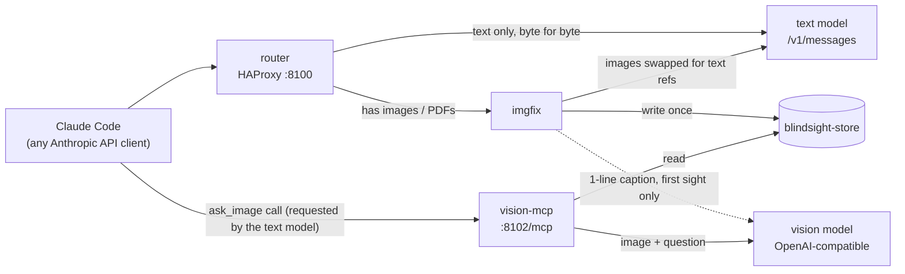

# blindsight

**Give text-only LLMs eyes.**

blindsight lets a text-only model served behind the Anthropic Messages API (e.g. GLM-5.3 used from Claude Code)
handle images and PDFs. A proxy swaps every image for a short text reference, and an MCP tool, `ask_image`, lets the
text model ask a separate vision model targeted questions about it.

## Demo


GLM-5.3 (text-only) in Claude Code, run from T3 Code (a GUI for coding agents; the thread list is blurred): the user
drops in a photo and asks what it is, then whether the connector is burnt. GLM answers each question with one
`ask_image` call. Clip is sped up.
[Full-resolution MP4](docs/demo.mp4).

## The problem

Text-only models behind the Anthropic API reject image blocks with HTTP 400. In Claude Code the image then stays in
the history, so every later turn fails too: the session is "poisoned".

## How it works



1. **router** (HAProxy, `:8100`) is the only API address your client uses (the MCP tool is registered separately,
   step 3). Text-only requests go straight to the text model, byte for byte.
2. Requests with `image` or `document` blocks go to **imgfix** (a mitmproxy addon). It stores each file under a
   content-hashed id and replaces the block with fixed text:
   ```
   [image img_<16hex> | WxH fmt | caption] The model cannot see images. To inspect this one, call the ask_image tool with image_id="img_<16hex>" and a specific question.
   ```
   The caption is one sentence from the vision model, made on first sight only (left empty if that call fails, times
   out or is cut off). PDFs become their `pdftotext` text plus a `pdf_<16hex>` id whose pages `ask_image` can
   render.
3. The text model calls **`ask_image(image_id, question, context?, page?, region?)`** on **vision-mcp**
   (`:8102/mcp`). It shows the stored image (or a zoomed `region`, or a rendered PDF `page`) to the vision model and
   returns the answer as text.

The swap runs on every request, so images already in the history are covered too.

## Design points

- **Prefix-cache friendly.** The store is write-once and references are built only from it, so the same image yields
  byte-identical text every turn and the text model's prefix cache keeps hitting.
- **Fail closed.** An image never reaches the text model. A block that can't be handled becomes
  `[image unavailable: could not be decoded]`. Bodies too big for HAProxy to inspect (~30 MiB and up) also go through
  imgfix. If imgfix is down, those and all image/document requests get a clear, non-retryable 400 telling you to run
  `docker compose up -d imgfix`; text-only requests under ~30 MiB are unaffected.
- **No remote fetches.** Image/document URLs are never downloaded; they become
  `[image url_<16hex> | remote image not fetched: <url>]` (documents:
  `[document url_<16hex> | remote document not fetched: <url>]`).
- **Limits.** Images up to 50 MP and 32 MiB each; PNG, JPEG, GIF, WebP; request bodies up to 64 MiB. New files are
  refused while the store's disk has less than `IMGFIX_MIN_FREE_GB` free.
- **Read-only token counting.** `/v1/messages/count_tokens` stores nothing and requests no captions.
- **Hardened containers.** Non-root, read-only filesystems, memory/CPU/PID limits, poppler under `prlimit`,
  DNS-rebinding guard on the MCP endpoint, ports bound to `127.0.0.1` by default.

## Works with

- **Client:** anything speaking the Anthropic Messages API (tested with Claude Code).
- **Text model:** any server exposing `/v1/messages` over plain HTTP (e.g. vLLM, SGLang).
- **Vision model:** any OpenAI-compatible `chat/completions` endpoint (e.g. vLLM, Ollama, llama.cpp server,
  LM Studio, or a hosted API via `VISION_API_KEY`).

## Quick start

Requires Docker with Compose.

```sh
cp .env.example .env    # set TEXT_HOST, TEXT_PORT, VISION_BASE_URL, VISION_MODEL
docker compose up -d --build --wait
docker compose ps       # router, imgfix and vision-mcp should all be "healthy"
```

If `--wait` fails or a service is not healthy, run `docker compose logs imgfix vision-mcp`: a configuration error
(e.g. invalid `VISION_EXTRA_BODY`) stops the service at startup with a clear message.

Then set up Claude Code, from the directory where you will work with the text model:

```sh
# Register the tool for this directory only
claude mcp add --scope local --transport http vision http://127.0.0.1:8102/mcp

# Point Claude Code at the router
ANTHROPIC_BASE_URL=http://127.0.0.1:8100 \
ANTHROPIC_AUTH_TOKEN=<your text server's API key, or any placeholder> \
ANTHROPIC_MODEL=<your text model's served name> \
ANTHROPIC_DEFAULT_HAIKU_MODEL=<the same name> \
claude
```

- `ANTHROPIC_DEFAULT_HAIKU_MODEL`: Claude Code also makes small background calls (e.g. session titles) with its
  "haiku" model, so it must name a model your server serves.
- `--scope local` keeps `ask_image` out of your other Claude Code sessions. With `--scope user` it is in every session,
  including ones with image-capable models, where its "you cannot see images" text is wrong, and it shows as failed
  whenever blindsight is stopped.
- Sessions started before the tool was registered won't have `ask_image`; start a new one.
- Optional: allow `mcp__vision__ask_image` in Claude Code permissions to skip the prompt on each call.

The stack does not start by itself. After a reboot or Docker restart, run `docker compose up -d` in this directory
again; until then every request to the router fails, not just image ones. To have Docker restart it, add a
`compose.override.yaml` (git-ignored) next to `compose.yaml`:

```yaml
services:
  router: { restart: unless-stopped }
  imgfix: { restart: unless-stopped }
  vision-mcp: { restart: unless-stopped }
```

## Configuration

Set in `.env` (each variable is documented in `.env.example`).

| Variable | Default | Meaning |
|---|---|---|
| `TEXT_HOST` | `host.docker.internal` | Text-only model server (plain HTTP, Anthropic `/v1/messages`). |
| `TEXT_PORT` | `8000` | Its port. |
| `VISION_BASE_URL` | `http://host.docker.internal:8001/v1` | OpenAI-compatible base URL, http or https: either ending in `/v1`, or a bare `host:port` (`/v1` is appended). Requests go to `<base>/chat/completions`. |
| `VISION_MODEL` | *(required)* | Vision model name sent in each request. |
| `VISION_API_KEY` | *(empty)* | Optional Bearer token, used for captions and `ask_image`. Never logged. |
| `VISION_EXTRA_BODY` | `{}` | JSON object merged into every vision request, e.g. `{"chat_template_kwargs":{"enable_thinking":false}}` for Qwen3-style thinking models on vLLM. Invalid JSON fails at startup. |
| `BIND_ADDR` | `127.0.0.1` | Address the published ports bind to. |
| `ROUTER_PORT` | `8100` | Router port (point your client here). |
| `MCP_PORT` | `8102` | MCP port (endpoint `/mcp`). |
| `MCP_ALLOWED_HOSTS` | `127.0.0.1:*,localhost:*,vision-mcp:*` | Host-header allowlist for the MCP endpoint (DNS-rebinding guard); `*` disables it. |
| `IMGFIX_MIN_FREE_GB` | `5` | Below this much free disk, new images/PDFs become "unavailable" text. |

`host.docker.internal` is the Docker host. Docker Desktop (macOS, Windows) forwards it to the host's loopback, so
model servers listening on `127.0.0.1` work. On Linux it is the Docker bridge address (via `extra_hosts`), so model
servers on the host must listen on `0.0.0.0` or that bridge address, not only `127.0.0.1` (e.g. `OLLAMA_HOST=0.0.0.0`,
`llama-server --host 0.0.0.0`, SGLang `--host 0.0.0.0`, LM Studio "Serve on Local Network"), and a host firewall
(e.g. ufw) must allow traffic from Docker's bridge networks. Or set `TEXT_HOST` and `VISION_BASE_URL` to another
address the containers can reach.

Neither port has authentication. If you set `BIND_ADDR` to a LAN address, add that `host:port` to
`MCP_ALLOWED_HOSTS`, and note that anyone who can reach it can use your models.

## The image store

Images, PDFs and their metadata live in the named volume `blindsight-store` (Docker name
`blindsight_blindsight-store`). `docker compose down` keeps it; `docker compose down -v` deletes it.

Nothing is pruned automatically. To prune by hand (never delete `meta/`: it keeps old references byte-stable; a pruned
file comes back when the same image is sent again, until then `ask_image` reports an unknown id):

```sh
# size
docker compose run --rm --no-deps --entrypoint du imgfix -sh /store/img /store/pdf /store/meta
# raw files older than 30 days
docker compose run --rm --no-deps --entrypoint find imgfix /store/img /store/pdf -type f -mtime +30 -print -delete
# stale temp files
docker compose run --rm --no-deps --entrypoint find imgfix /store -name '.tmp-*' -mmin +60 -print -delete
```

## Tests

All run in Docker with stub models; no GPU needed.

```sh
docker compose -f imgfix/compose.dev.yaml run --rm --build test
docker compose -f vision-mcp/compose.dev.yaml run --rm --build test
test/run.sh    # full stack: router + imgfix + vision-mcp; cleans up after itself
```

## Real-world deployment

Deployed in front of GLM-5.3 (753B MoE, text-only) on 8x NVIDIA CMP 170HX
([recipe](https://github.com/cebeuq/glm53-cmp170hx-recipe)), with a Qwen3.8-27B vision model on a 9th card. From
production logs:

- The image swap adds ~16-22 ms per request.
- Each `ask_image` call takes ~1.2-2.8 s.
- The prefix cache keeps working, because references are byte-identical every turn.

## Limitations

- Client side speaks the Anthropic Messages API only (not OpenAI chat format).
- The text model upstream must be plain HTTP.
- Captions and answers are only as good as the vision model.

## License

MIT. See [LICENSE](LICENSE).
